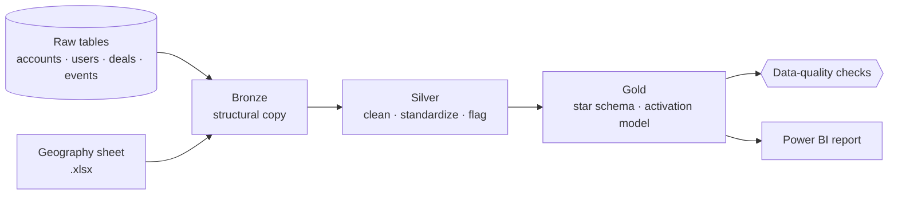
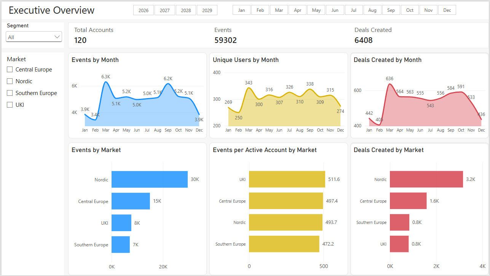
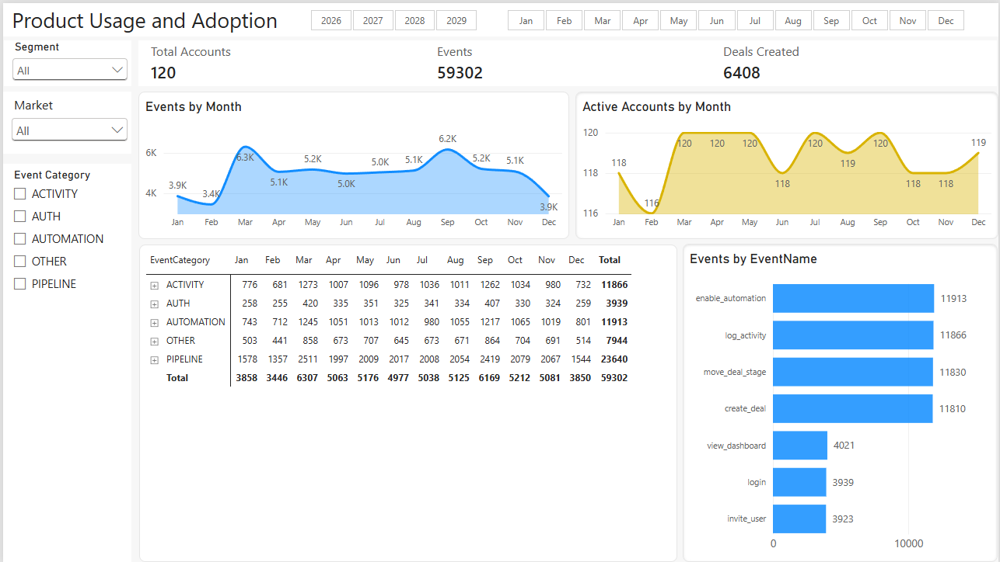
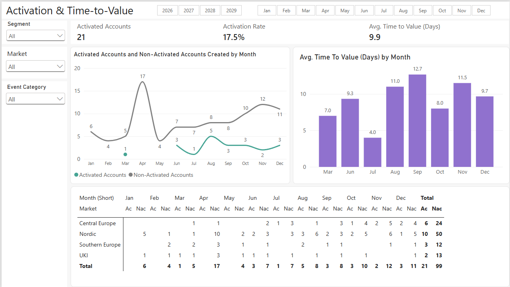
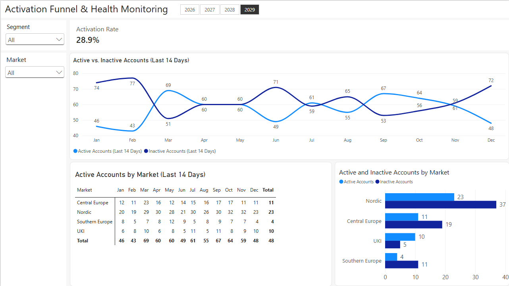

# Product Analytics Lakehouse

A Bronze/Silver/Gold data pipeline in DuckDB and Python that turns raw SaaS product data into a tested, BI-ready star schema and an account activation model.

**Stack:** Python · SQL (DuckDB) · Power BI · DAX  
**Case study:** [othmaneoumnad.github.io](https://othmaneoumnad.github.io/product-analytics-lakehouse-medallion-pipeline.html)

## Context

NordicFlow CRM is a fictional European B2B SaaS company that sells a CRM to small and mid-sized businesses. The case and its synthetic dataset come from the PortfolioStack product analytics program; the pipeline, data-quality handling, and analysis in this repository are my own work.

## The business problem

Leadership had four concerns:

- Trial sign-ups were rising, but activation was inconsistent.
- Many users logged in without adopting core features such as pipeline management, deal progression, and automation.
- Early churn was appearing, especially among smaller accounts.
- Different teams' reports gave conflicting numbers.

The pipeline provides a single, tested source of truth, and the activation model separates real adoption from log-ins.

## Architecture



| Layer | What happens |
|---|---|
| **Bronze** | Structural copy of the raw sources (four DuckDB tables and one Excel sheet). No transformation. |
| **Silver** | Cleaning and standardization, derived fields (account age, deal cycle, user recency, event category), and data-quality flags. |
| **Gold** | Business-facing star schema, a pre-aggregated events table for BI performance, and the activation model. |

**Gold tables**

| Table | Grain |
|---|---|
| `gold_dim_accounts` | One row per account |
| `gold_dim_users` | One row per user |
| `gold_dim_geography` | One row per country |
| `gold_fact_product_events` | One row per product event |
| `gold_fact_product_events_aggregated` | One row per date, event, and account |
| `gold_fact_deals` | One row per deal |
| `gold_fact_advanced_activation` | One row per account, with activation outcome and time to value |

## Data quality

Issues found in the raw data and how each is handled:

| Issue | Rows | Handling |
|---|---:|---|
| Test events | 1,195 | Removed in silver |
| Events with no event ID | 616 | Flagged in silver, excluded from gold |
| Events with no account | 641 | Flagged in silver, excluded from gold |
| Events with a valid account but no user | 1,128 | Kept as account activity; flagged (`HasValidUser`) so user counts can exclude them |
| Events logged under an account other than the user's own (artifact of the synthetic data) | 57,056 | Kept; user counts are not broken down by account attributes such as market, which would double-count users |
| Duplicate deals | 35 | Deduplicated in silver |
| Deal amounts in five currencies (EUR, DKK, NOK, SEK, GBP) | 6,408 | Converted to EUR (`DealAmountEUR`) at fixed ECB reference rates; original amount and currency kept |
| Event-name variants (`Login`, `user_login`, `ViewDashboard`) | 260 | Standardized; original name kept in `event_name_raw` |
| Inconsistent account-status casing | 1 | Standardized |
| Geography sheet: lowercase country code, duplicate row, missing market | 3 | Fixed in silver |

Product events: 61,747 raw → 60,552 after removing test events → 59,302 in gold.

`checks/data_quality_checks.py` runs 12 checks after every build (unique keys, valid relationships, standard values, activation logic). The build fails if any check fails.

## Activation model

An account counts as **activated** when, within 14 days of signing up, it shows both:

1. product usage tied to a deal (a core CRM action, not just a log-in), and
2. a deal created.

The activation date is the later of the two signals; time to value is the number of days from sign-up to activation. A log-in is activity, not value: requiring both usage and a commercial outcome separates accounts that run their sales process in the product from accounts that only explored it.

Logic: [`gold/gold_fact_advanced_activation.py`](gold/gold_fact_advanced_activation.py)

## Results

**Activation funnel** (first 14 days after sign-up)

| Stage | Accounts | Share |
|---|---:|---:|
| Signed up | 120 | 100% |
| Showed at least one signal | 89 | 74% |
| Used the product on a deal | 60 | 50% |
| Created a deal | 50 | 42% |
| **Activated (both signals)** | **21** | **17.5%** |

- **Most early engagement stalls halfway.** 68 of the 89 engaged accounts showed one signal but not the other. Onboarding should connect product usage to the first deal.
- **Activation is slow even when it happens.** Activated accounts took 9.9 days on average (median 10), and 18 of 21 needed a week or more.
- **Deals:** 58.5% win rate on closed deals, a 62-day median sales cycle, and €12.9M won.
- **Concentration:** the Nordic market accounts for half of all accounts, product events, and deals. Events per active account are similar across markets (about 470 to 510), so the Nordic lead comes from having more customers, not from heavier use.

The data is synthetic, so these figures demonstrate the method rather than describe a real company.

## Power BI report

The report reads only the gold tables, so its figures match the pipeline. It holds 23 DAX measures ([`powerbi/measures.dax`](powerbi/measures.dax)) and a date table that spans every year in the data ([`powerbi/dim_date.dax`](powerbi/dim_date.dax)). The first three pages below show the full dataset; the health page shows 2029, because its 14-day activity windows need a reference date.

**Executive Overview:** accounts, product events, and deals by month and market.



**Product Usage and Adoption:** feature usage by category, event, and month.



**Activation and Time-to-Value:** activated accounts, activation rate, and time to value by sign-up month and market.



**Activation Funnel and Health Monitoring (2029):** accounts active in the last 14 days of each month, by market.



**Opening the report.** [`powerbi/product-analytics-report.pbit`](powerbi/product-analytics-report.pbit) is a Power BI template: it contains the model, measures, and pages, but no data. It needs the DuckDB Power Query connector and the database built by the pipeline; update the database path in each query's Source step.

## How to run

Requires Python 3.10+.

```bash
python -m venv .venv
source .venv/bin/activate
pip install -r requirements.txt
python run_pipeline.py
```

The source data is not included in this repository. The pipeline expects two files in a `data/` folder:

- `data/product_analytics_light.db`: a DuckDB database with `raw__accounts`, `raw__users`, `raw__deals`, and `raw__product_events`
- `data/geography.xlsx`: the country-to-market mapping

## Repository structure

```
├── data/              # source data and DuckDB database (not included)
├── bronze/            # structural copy of the raw sources
├── silver/            # cleaning, standardization, data-quality flags
├── gold/              # star schema, aggregates, activation model
├── checks/            # data-quality checks run after every build
├── powerbi/           # report template (.pbit), DAX measures, date table, screenshots
├── run_pipeline.py    # runs every step in dependency order
└── requirements.txt
```

## Limitations

- The data is synthetic, so the findings show the approach rather than real customer behavior.
- One fixed set of exchange rates (ECB, 6 Nov 2026) is applied to all dates.
- Event categories come from keyword matching on event names; a maintained lookup table would be sturdier.
- Age and recency fields are measured against today's date, while the synthetic data runs through 2029.

## Author

Othmane Oumnad · [Portfolio](https://othmaneoumnad.github.io/) · [LinkedIn](https://www.linkedin.com/in/othmaneoumnad)
